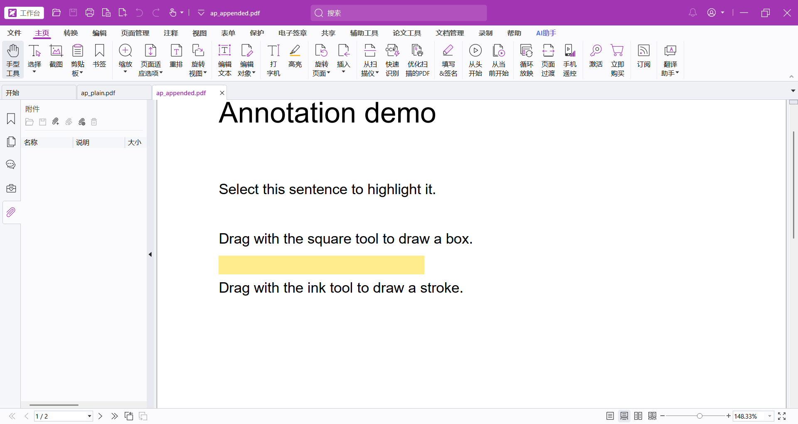

# 福昕功能矩阵：截图基线与本项目对齐状态

**生成方式：** `python scripts/build-foxit-matrix.py`（数据源 [`docs/benchmark/foxit-features.csv`](benchmark/foxit-features.csv)）  
**截图日期：** 2026-11-15  
**基线版本：** Foxit PDF Editor 2026.1.2.36547（Continuous）  
**规模：** 5 种状态 · 17 个标签页 + 1 组全局命令 · 276 条命令

这份文档把福昕每个标签页的功能逐条抄下来，并标上本项目的实现状态。它回答两个问题：**福昕有什么、我们缺什么**。能力编号（A1、C10……）对应 [对标基线](FOXIT_BENCHMARK.md) 的 95 项评分卡；标 `—` 表示评分卡没有单列。

> 状态按 **2026-11-16 重算**（基线提交 `bf6671a`，含当日页面组装与表单两批实现）：逐条回到 `src/` 里核「底层实现 → 能否写盘 → 界面入口 → 验收」四层，四层齐备才算「已对齐」。只实现了一半、或按钮在但功能不对口的，按「部分」记。

## 1. 截图档案

全部 17 张截图在 [`docs/benchmark/foxit/`](benchmark/foxit/README.md)，每张都登记了标签页、像素尺寸与 SHA-256。

| 标签页 | 截图 | 说明 |
|---|---|---|
| 文件 | [`01-file-tab.png`](benchmark/foxit/01-file-tab.png) | 文件页 + 最近文档 + 左侧文件命令栏 |
| 主页 | [`02-home.png`](benchmark/foxit/02-home.png) | 打开、阅读、注释、页面、扫描、放映、AI 翻译 |
| 转换 | [`03-convert.png`](benchmark/foxit/03-convert.png) | 输入、打包、组装、输出格式、OCR、印前 |
| 编辑 | [`04-edit.png`](benchmark/foxit/04-edit.png) | 文本/对象编辑、插入、链接、书签、附件 |
| 页面管理 | [`05-page-management.png`](benchmark/foxit/05-page-management.png) | 页面排序、组装、裁剪、水印/背景/页眉页脚/页码 |
| 注释 | [`06-comment.png`](benchmark/foxit/06-comment.png) | 标记、标注、绘图、测量、图章、审阅与导入导出 |
| 视图 | [`07-view.png`](benchmark/foxit/07-view.png) | 布局、阅读模式、视觉模式、朗读与比较 |
| 表单 | [`08-form.png`](benchmark/foxit/08-form.png) | 建域、XFA、计算、数据导入导出、JavaScript |
| 保护 | [`09-protect.png`](benchmark/foxit/09-protect.png) | 密文、隐藏数据、加密、签名、时间戳、验证 |
| 电子签章 | [`10-sign.png`](benchmark/foxit/10-sign.png) | 云端签署平台与本地签章 |
| 共享 | [`11-share.png`](benchmark/foxit/11-share.png) | 邮件、协作、审阅与企业管理连接器 |
| 辅助工具 | [`12-accessibility.png`](benchmark/foxit/12-accessibility.png) | 无障碍标签、检查、阅读顺序 |
| 论文工具 | [`13-thesis.png`](benchmark/foxit/13-thesis.png) | 论文查重 |
| 文档管理 | [`14-doc-management.png`](benchmark/foxit/14-doc-management.png) | 标签、分类、全文检索、发票与批量 |
| 录制 | [`15-record.png`](benchmark/foxit/15-record.png) | PDF/屏幕/声音录制与截图 |
| 帮助 | [`16-help.png`](benchmark/foxit/16-help.png) | 手册、插件、激活与订阅 |
| AI助手 | [`17-ai-assistant.png`](benchmark/foxit/17-ai-assistant.png) | 聊天、翻译、朗读、内容检测、生成 PPT |

## 2. 状态图例

| 标记 | 状态 | 判定 |
|---|---|---|
| ✅ | 已对齐 | 功能在、结果一致、没有明显降级 |
| 🟨 | 部分 | 主路径能走通，深度或入口还差一截 |
| ⬜ | 未做 | 还没有实现，已排进路线或待排 |
| 🚫 | 不做 | 评分卡明确排除，理由见 FOXIT_BENCHMARK 1.2 |
| ➖ | 非目标 | 账号、订阅、云服务或企业集成，不进入产品范围 |

对齐率只把 ✅ 算作对齐；🟨 单列，避免「有一个按钮就算对齐」的自我安慰。

## 3. 总览

| 标签页 | 条目 | ✅ 已对齐 | 🟨 部分 | ⬜ 未做 | 🚫 不做 | ➖ 非目标 | 对齐率 |
|---|---:|---:|---:|---:|---:|---:|---:|
| 文件 | 22 | 11 | 2 | 6 | 0 | 3 | 50% |
| 全局 | 2 | 1 | 1 | 0 | 0 | 0 | 50% |
| 主页 | 26 | 15 | 3 | 3 | 1 | 4 | 58% |
| 转换 | 25 | 5 | 3 | 16 | 0 | 1 | 20% |
| 编辑 | 20 | 12 | 5 | 1 | 2 | 0 | 60% |
| 页面管理 | 20 | 17 | 3 | 0 | 0 | 0 | 85% |
| 注释 | 28 | 19 | 4 | 5 | 0 | 0 | 68% |
| 视图 | 17 | 5 | 4 | 7 | 1 | 0 | 29% |
| 表单 | 19 | 13 | 5 | 0 | 1 | 0 | 68% |
| 保护 | 14 | 5 | 6 | 2 | 0 | 1 | 36% |
| 电子签章 | 14 | 1 | 2 | 3 | 0 | 8 | 7% |
| 共享 | 13 | 8 | 0 | 1 | 4 | 0 | 62% |
| 辅助工具 | 11 | 2 | 4 | 5 | 0 | 0 | 18% |
| 论文工具 | 2 | 2 | 0 | 0 | 0 | 0 | 100% |
| 文档管理 | 15 | 14 | 1 | 0 | 0 | 0 | 93% |
| 录制 | 5 | 0 | 5 | 0 | 0 | 0 | 0% |
| 帮助 | 13 | 3 | 1 | 1 | 2 | 6 | 23% |
| AI助手 | 10 | 1 | 1 | 8 | 0 | 0 | 10% |
| **合计** | **276** | **134** | **50** | **58** | **11** | **23** | **49%** |

去掉 🚫 与 ➖ 之后，真正要比的是 **242 条**：已对齐 134、部分 50、未做 58。

## 4. 逐标签页清单

### 文件（22 条）

| 组 | 命令 | 状态 | 能力 | 说明 |
|---|---|---|---|---|
| 文件操作 | 打开 | ✅ | — | 命令行/拖放/最近文档 |
| 文件操作 | 创建 | ⬜ | E7 | 只能插入空白页，不能新建文档 |
| 文件操作 | 属性 | ✅ | — | 读 PDF 的 /Info 并可改写回；有专项单测 |
| 文件操作 | 保存 | ✅ | — | 临时文件→重开校验→原子替换 |
| 文件操作 | 另存为 | ✅ | — | 可换路径并保留备份 |
| 文件操作 | 关闭 | ✅ | — | 标签页关闭并清理 |
| 打印 | 打印 | ✅ | H1 | 范围与份数可用；输出到打印机或 PDF |
| 打印 | 批量打印 | ⬜ | D9 | 没有批量打印；批量能力只有重命名与 OFD 转换 |
| 打印 | 高级打印 | 🟨 | H1 | 双面/多页合一取决于打印驱动 |
| 打印 | 发票打印 | ⬜ | — | 地区性发票排版 |
| 打印 | 打印模板 | ⬜ | — | 没有模板管理 |
| 共享与恢复 | 共享 | ➖ | — | 云协作非目标 |
| 共享与恢复 | 恢复 | ✅ | — | 恢复日志可重放未保存命令 |
| 共享与恢复 | 本地备份 | ✅ | — | 保存时留下 .folixa.bak |
| 导出与工具 | 导出 | ✅ | H3 | 导出页面图片与纯文本 |
| 导出与工具 | PDF优化 | 🟨 | H8 | 调 Ghostscript 压缩；依赖本机安装 gs，无体积断言 |
| 导出与工具 | 索引 | ✅ | — | 本地分块索引与检索 |
| 导出与工具 | 动作向导 | ⬜ | D9 | 没有动作向导编排 |
| 导出与工具 | 皮肤 | ⬜ | — | 当前只有浅色主题 |
| 最近文档 | 最近文档 | ✅ | — | 显示文件名/路径/时间 |
| 最近文档 | 云文档 | ➖ | — | 没有云盘接入 |
| 最近文档 | 添加一个位置 | ➖ | — | 同上 |

### 全局（2 条）

> 手型和选择固定在每个 Ribbon 左侧，这里只记一次。

| 组 | 命令 | 状态 | 能力 | 说明 |
|---|---|---|---|---|
| 导航 | 手型工具 | 🟨 | — | 没有手型拖拽平移；滚轮与滚动条可用 |
| 导航 | 选择 | ✅ | — | 文本选择/复制/双击选词 |

### 主页（26 条）

| 组 | 命令 | 状态 | 能力 | 说明 |
|---|---|---|---|---|
| 捕获 | 截图 | 🟨 | — | 只有整窗截图（grab()），无区域框选 |
| 捕获 | 剪贴板 | 🟨 | — | 只能复制文本；无图像与富内容 |
| 导航 | 书签 | ✅ | B3 | 浏览跳转 + 新建/改名/删除 + 排序与层级编辑；有专项单测 |
| 显示 | 缩放 | ✅ | A6 | 25%–400% + 适应宽度/页面 |
| 显示 | 页面适合 | ✅ | A6 | 适合宽度与适合页面 |
| 显示 | 重排 | 🚫 | A8 | 重排质量不可用，由朗读与 AI 摘要替代 |
| 显示 | 旋转视图 | ✅ | A7 | 只转视图，不改页面 |
| 内容 | 编辑文本 | ✅ | E1 | 就地编辑 + 文字属性，可写盘 |
| 内容 | 编辑对象 | ✅ | E2 | 对象选择/拖拽/旋转/缩放/删除，可撤销 |
| 注释 | 打字机 | ✅ | C4 | FreeText 带外观流与 /DA |
| 注释 | 高亮 | ✅ | C1 | 文本选区高亮 |
| 页面 | 旋转页面 | ✅ | D1 | 写页面 /Rotate，可撤销 |
| 页面 | 插入页面 | ✅ | D1 | 当前页后插入空白页；也可从别的文件插入页面 |
| 扫描 | 从扫描仪 | ⬜ | H6 | 需要 WIA/TWAIN 接入 |
| 扫描 | 快速识别 | ✅ | I1 | Tesseract 或 Windows OCR |
| 扫描 | 优化扫描的PDF | 🟨 | I1 | 只有图像预处理；没有完整去噪/纠偏 |
| 表单 | 填写&签名 | ✅ | F1 | 表单填写 + 证书签名（随包 pyHanko） |
| 放映 | 从头开始 | ✅ | A5 | F5 全屏逐页 |
| 放映 | 从当前页开始 | ✅ | A5 | 从当前页进入放映 |
| 放映 | 循环放映 | ⬜ | A5 | 没有循环播放选项 |
| 放映 | 页面过渡 | ⬜ | — | 没有过渡动画 |
| 放映 | 手机遥控 | ➖ | — | 需要移动端 |
| 商业 | 激活 | ➖ | — | 无账号体系 |
| 商业 | 立即购买 | ➖ | — | 无订阅 |
| 商业 | 订阅 | ➖ | — | 无订阅 |
| AI | 翻译助手 | ✅ | L2 | 翻译选区/当前页 |

### 转换（25 条）

| 组 | 命令 | 状态 | 能力 | 说明 |
|---|---|---|---|---|
| 输入 | 文件转换 | 🟨 | H6 | Office→PDF 走本机 LibreOffice；扫描仪/剪贴板/网页仍无 |
| 输入 | 从扫描仪 | ⬜ | H6 | 同上 |
| 输入 | 从剪贴板 | ⬜ | — | 没有剪贴板转 PDF |
| 输入 | 从网页 | ⬜ | — | 没有网页抓取 |
| 输入 | 从CAJ | ➖ | — | 地区性格式 |
| 输入 | 表单 | ⬜ | — | 没有表单文件转换 |
| 打包 | PDF文件包 | ⬜ | — | 不支持 Portfolio |
| 打包 | 制作活页夹 | ⬜ | — | 同上 |
| 组装 | 合并文件 | 🟨 | D2 | 单选一次并一份；跨文件书签不随页搬运 |
| 组装 | 空白页 | ✅ | D1 | 插入空白页 |
| 输出 | 导出全部图像 | ✅ | H3 | 按 DPI 导出 PNG/JPEG |
| 输出 | 到MS Office | ⬜ | H5 | 入口禁用占位，未实现 |
| 输出 | 到图片 | ✅ | H3 | 与导出图片同一条通路 |
| 输出 | 到HTML | ⬜ | — | 没有 HTML 导出 |
| 输出 | 转为基于图像的PDF | ⬜ | — | 没有整页栅格化导出 |
| 输出 | 到CAD | ⬜ | — | 没有 CAD |
| 输出 | 到其它格式 | ⬜ | — | 没有其它格式 |
| 输出 | 到PDF | 🟨 | H6 | Office/HTML→PDF 走 LibreOffice；非任意文件 |
| 输出 | 到OFD | ⬜ | — | 没有 OFD |
| 输出 | OFD批量转换 | ⬜ | — | 同上 |
| OCR | 识别文本 | ✅ | I1 | 识别结果进本地索引，可检索可问答；未回写 PDF 隐藏文本层 |
| OCR | 快速识别 | ✅ | I1 | 与 OCR 同一引擎 |
| OCR | 疑似错误 | ⬜ | — | 没有识别纠错 |
| 印前 | 印前检查 | ⬜ | — | 没有印前检查 |
| 印前 | PDF转曲 | ⬜ | E5 | 没有字体转曲 |

### 编辑（20 条）

| 组 | 命令 | 状态 | 能力 | 说明 |
|---|---|---|---|---|
| 内容 | 编辑文本 | ✅ | E1 | 行级重写 + 就地编辑，可写盘 |
| 内容 | 编辑对象 | ✅ | E3 | 选择/移动/旋转/缩放/删除，可撤销 |
| 内容 | 链接&合并文本 | ⬜ | E4 | 没有文本块链接与合并 |
| 文本工具 | 拼写检查 | 🟨 | — | 内置 3066 词 + 94 组常见拼错 + 启发式规则；有专项单测；词表远小于完整词典，会漏判，不查中文 |
| 文本工具 | 搜索&替换 | ✅ | B5 | 查找与替换都能走通；批量替换复用同一对话框 |
| 文本工具 | 批量替换 | ✅ | — | 规则表按顺序依次生效，支持区分大小写/全字/正则；有专项单测 |
| 插入 | 添加文本 | ✅ | C4 | FreeText 文本框 |
| 插入 | 添加图像 | ✅ | C7 | 图片图章/图片注释 |
| 插入 | 添加形状 | ✅ | C5 | 矩形/椭圆/线/箭头/多边形/云线 |
| 内容 | 流式编辑 | 🚫 | A8 | 依赖重排，不做 |
| 插入 | 添加文章框 | ✅ | — | 多行正文框可插入并落盘 |
| 链接 | 添加链接 | ✅ | E4 | 网址链接与页内跳转都能写盘 |
| 链接 | 网络链接 | ✅ | E4 | 可加外链，并能自动识别文本中的网页链接 |
| 导航 | 书签 | ✅ | B3 | 新建/改名/删除/排序/层级编辑都可点；有专项单测 |
| 导航 | 自动创建书签 | 🟨 | B3 | 按字高比正文大的行判定标题并生成大纲；有专项单测；不读标签树，误判风险仍在 |
| 导航 | 交叉引用 | 🟨 | — | 插入指向书签的引用文字并可点跳转；目标要手工挑，不会自动识别「见第 N 页」这类引用 |
| 附件 | 文件附件 | 🟨 | C8 | 只有批注级附件；文档级附件面板是空壳，未参与构建 |
| 附件 | 图像标注 | ✅ | C7 | 图片图章 |
| 附件 | 音频&视频 | 🟨 | C8 | 录音以 WAV 附件保存；无视频 |
| 3D | 添加3D | 🚫 | A11 | 不追 3D/多媒体 |

### 页面管理（20 条）

| 组 | 命令 | 状态 | 能力 | 说明 |
|---|---|---|---|---|
| 页面 | 插入 | ✅ | D1 | 插入空白页；也可从别的文件插入页面 |
| 页面 | 删除 | ✅ | D1 | 删除当前页，可撤销 |
| 页面 | 提取 | ✅ | D3 | 提取当前页与按范围提取；切分逻辑抽到 PageSplitPlanner 并有专项单测 |
| 排序 | 逆序 | 🟨 | D2 | 整篇页面逆序可写盘 |
| 排序 | 重新排列 | ✅ | D1 | 上移/下移与任意位置移动都有 |
| 排序 | 移动 | ✅ | D2 | 任意位置移动有界面入口；走批注控制器，页码不错位 |
| 排序 | 复制 | ✅ | D2 | 复制当前页有入口有单测 |
| 排序 | 替换 | ✅ | D4 | 替换页有入口与专项单测 |
| 组装 | 拆分 | ✅ | D3 | 按范围/每 N 页/按书签/按体积四种都能拆；切分逻辑有专项单测 |
| 组装 | 交换 | 🟨 | D2 | 交换两页可写盘 |
| 组装 | 交叉合并 | 🟨 | D2 | 交叉合并有入口 |
| 页面 | 旋转页面 | ✅ | D1 | 写 /Rotate 并可撤销 |
| 页面 | 裁剪页面 | ✅ | D5 | CropBox 可写并有专项单测 |
| 页面 | 调整页面大小 | ✅ | D5 | 改尺寸并等比缩放内容，有单测 |
| 页面 | 扁平化 | ✅ | F2 | 表单扁平化 |
| 装饰 | 水印 | ✅ | D8 | 已接菜单入口并有专项单测；仅标准 14 字体 |
| 装饰 | 背景 | ✅ | D8 | 页面背景可设，有单测 |
| 装饰 | 页眉/页脚 | ✅ | D8 | 已接菜单入口；仅标准 14 字体 |
| 装饰 | 贝茨编号 | ✅ | D8 | 编号引擎有入口并有专项单测 |
| 装饰 | 格式化页码 | ✅ | D8 | 界面可输入页码格式（%1 当前页、%2 总页数） |

### 注释（28 条）

| 组 | 命令 | 状态 | 能力 | 说明 |
|---|---|---|---|---|
| 标记 | 高亮 | ✅ | C1 | 带 /AP 外观流 |
| 标记 | 下划线 | ✅ | C1 | 带 /AP 外观流 |
| 标记 | 删除线 | ✅ | C1 | 带 /AP 外观流 |
| 标记 | 波浪线 | ✅ | C2 | 外观流 + 画布绘制 |
| 标注 | 备注 | ✅ | C3 | 便签 |
| 标注 | 文件 | ✅ | C8 | 文件附件批注 |
| 标注 | 打字机 | ✅ | C4 | 自由文本 |
| 标注 | 文本框 | ✅ | C4 | 带边框的 FreeText |
| 标注 | 注释框 | ⬜ | C5 | 没有 callout 箭头框 |
| 绘图 | 绘图 | ✅ | C5 | 矩形/椭圆/线/箭头/多边形/云线 |
| 绘图 | 铅笔 | ✅ | C6 | 墨迹与整笔擦除 |
| 绘图 | 橡皮 | ✅ | C6 | 整笔删除 |
| 高亮工具 | 区域高亮 | ⬜ | — | 没有区域高亮 |
| 高亮工具 | 搜索&高亮 | ✅ | B9 | 搜索结果高亮与跳转 |
| 测量 | 测量 | ✅ | C9 | 距离/周长/面积 + 比例尺 |
| 测量 | 会计计算器 | ⬜ | — | 没有计算器 |
| 图章 | 图章 | ✅ | C7 | 四种文字图章 |
| 图章 | 自定义图章 | ✅ | C7 | 图片图章 |
| 符号 | 符号 | ⬜ | — | 没有符号面板 |
| 符号 | 数字 | 🟨 | C7 | 只有文字图章，没有数字图章 |
| 符号 | 字母 | 🟨 | C7 | 同上 |
| 审阅 | 小结注释 | ✅ | C12 | 批注摘要 HTML/打印 |
| 审阅 | 导入 | ✅ | C12 | XFDF 导入 |
| 审阅 | 导出 | ✅ | C12 | XFDF/HTML 导出 |
| 审阅 | 邮件发送PDF | ✅ | K1 | 调默认邮件客户端并复制路径供贴附件 |
| 审阅 | 管理注释 | 🟨 | C11 | 列表/跳转/删除/回复；无批量筛选 |
| 工具 | 保持工具选择 | 🟨 | C6 | 工具互斥；用后回到选择 |
| 工具 | 批注模式 | ⬜ | — | 没有连续批注模式 |

### 视图（17 条）

| 组 | 命令 | 状态 | 能力 | 说明 |
|---|---|---|---|---|
| 阅读 | 阅读模式 | 🟨 | A4 | 专注模式隐藏面板；没有全屏沉浸阅读 |
| 阅读 | 重排 | 🚫 | A8 | 明确不做 |
| 阅读 | 逆序阅读 | ⬜ | — | 逆序指整篇页面逆序，不是逆序阅读版式 |
| 显示 | 视觉模式 | ⬜ | A9 | 只有浅色主题；护眼/夜间未做 |
| 显示 | 文本查看器 | ⬜ | — | 没有纯文本视图 |
| 显示 | 旋转视图 | ✅ | A7 | 90° 步进并记忆 |
| 显示 | 切换标尺 | ⬜ | — | 没有标尺 |
| 布局 | 单页 | ✅ | A4 | 连续单页 |
| 布局 | 双页 | ✅ | A4 | 对开 |
| 布局 | 连续 | ✅ | A3 | 连续滚动 + 瓦片渲染 |
| 交互 | 自动滚动 | ⬜ | — | 没有自动滚动 |
| 交互 | 页面过渡 | ⬜ | — | 没有过渡 |
| AI | 助手 | 🟨 | L2 | AI 面板可总结/解释当前页与选区；需配置 Provider |
| 朗读 | 朗读 | 🟨 | J4 | 逐词朗读并逐词高亮；有专项单测；依赖系统语音合成，无音色/语速可调，长文逐词合成较慢 |
| 比较 | 比较 | ⬜ | L7 | 计划 2.0 |
| 统计 | 字数统计 | ✅ | — | 总字数/字符数/页数/标题数 + 每页分布；有专项单测 |
| 设置 | 视图设置 | 🟨 | A6 | 缩放/布局/面板可见性记忆 |

### 表单（19 条）

| 组 | 命令 | 状态 | 能力 | 说明 |
|---|---|---|---|---|
| 识别 | 执行表单自动识别 | 🟨 | F5 | 只枚举已有 AcroForm 字段，不识别无域表单页 |
| 设计 | 设计助手 | 🟨 | E7 | 按描述生成字段清单、确认后在当前页建域；有专项单测；不画版面、不跨页 |
| 建域 | 文本域 | ✅ | E7 | 可新建并落盘；经典 xref 与交叉引用流都能写 |
| 建域 | 复选框 | ✅ | E7 | 可新建并落盘；经典 xref 与交叉引用流都能写 |
| 建域 | 单选按钮 | ✅ | E7 | 可新建并落盘；同名单选共享 /Parent 父字段，勾一个其余自动取消 |
| 建域 | 组合框 | ✅ | E7 | 可新建并落盘；选项可维护；交叉引用流也能写 |
| 建域 | 列表框 | ✅ | E7 | 可新建并落盘；选项可维护；交叉引用流也能写 |
| 建域 | 按钮 | ✅ | E7 | 可新建并落盘；经典 xref 与交叉引用流都能写 |
| 建域 | 条形码 | ✅ | E7 | Code128 真条码画进外观流，扫描器能扫出来 |
| 模板 | 页面模板 | 🟨 | — | 可把当前页的域存成模板并按模板建域；没有内置模板库 |
| XFA | 编辑静态XFA表单 | 🚫 | F6 | PDFium 无 XFA 引擎，须显式提示 |
| 计算 | 计算次序 | ✅ | F3 | 按 AcroForm /CO 次序执行计算脚本，可调序并写回 |
| 设计 | 添加工具提示 | ✅ | F5 | 域属性可填提示，表单面板有提示列 |
| 填写 | 重置表单 | ✅ | F2 | 恢复字段默认值；没有默认值的清空 |
| 数据 | 表单到工作表 | 🟨 | F4 | 导出 Excel 可打开的 CSV，不是 xlsx |
| 数据 | 导入 | ✅ | F4 | CSV/FDF/XFDF 都可用 |
| 数据 | 导出 | ✅ | F4 | CSV/FDF/XFDF 都可用 |
| 脚本 | JavaScript | ✅ | F3 | 内置 JS 子集求值器，可写脚本并把结果写回字段 |
| 设置 | 工具设置 | 🟨 | F5 | 新建域默认字体/字号/颜色写入 /DA 并本地留存；有专项单测；只给标准 14 字体三档 |

### 保护（14 条）

| 组 | 命令 | 状态 | 能力 | 说明 |
|---|---|---|---|---|
| 密文 | 标记为密文 | ✅ | G4 | 盖黑块提示，原文仍在文件里、仍可搜到；这正是「标记」的语义 |
| 密文 | 马赛克 | ✅ | G4 | 区域像素化并删相交对象，文字层读不到该区域；有专项单测 |
| 密文 | 擦除 | ✅ | G4 | 删相交对象，文字层读不到；页面其余仍是矢量文字；有专项单测 |
| 密文 | 保护密文 | ✅ | G4 | 整页位图化落实标记，页面失去文字层；有专项单测 |
| 隐私 | 隐藏数据 | 🟨 | G3 | 清名称树、元数据与嵌入文件本体（新增 removeEmbeddedFiles 清文件流与 /FileAttachment 引用点）；其他隐藏向量仍未全覆盖 |
| 文档 | 安全文档 | 🟨 | G8 | AI 调用走独立 Worker；PDF 解析仍在主进程 |
| 文档 | 限制访问 | 🟨 | G1 | AES-256 + 七项权限位 + 运行时拦截；需带 qpdf 的构建 |
| 文档 | 批量加密 | ⬜ | G1 | 没有批量 |
| 设置 | 设置 | ⬜ | — | 没有保护设置面板 |
| 企业 | 敏感度 | ➖ | — | 企业敏感度标签 |
| 签名 | 填写&签名 | ✅ | F1 | 表单填写与证书签名均可用 |
| 签名 | 签名&认证 | 🟨 | G5 | PKCS#12 证书签名走随包 pyHanko |
| 签名 | 时间戳文档 | 🟨 | G7 | 时间戳地址透传给 pyHanko |
| 签名 | 验证 | 🟨 | G6 | 新增签名列表与证书链面板（有专项单测）；pyHanko 验签输出仍是原始文本，未做逐项密码学判定 |

### 电子签章（14 条）

| 组 | 命令 | 状态 | 能力 | 说明 |
|---|---|---|---|---|
| 签署 | 对外签署 | ➖ | — | 云端电子签平台 |
| 签署 | 对内签署 | ➖ | — | 同上 |
| 签章 | 管理对外签章 | 🟨 | G5 | 本地签章库（PNG 存本地）可管理；无对外平台 |
| 签章 | 骑缝章 | ✅ | G5 | 骑缝章有入口与实现 |
| 签署 | 邀请他人签署 | ➖ | — | 需要服务端 |
| 签章 | 签章 | 🟨 | G5 | 手写或导入签章并盖到页面 |
| 流程 | 签署流程 | ⬜ | — | 没有流程 |
| 流程 | 签署报告 | ⬜ | — | 没有报告 |
| 流程 | 签署记录 | ⬜ | — | 没有记录 |
| 服务 | 分享反馈 | ➖ | — | 平台功能 |
| 服务 | 了解更多 | ➖ | — | 平台功能 |
| 服务 | 我的额度 | ➖ | — | 平台功能 |
| 服务 | 签署设置 | ➖ | — | 平台功能 |
| 签署 | 完成签署 | ➖ | — | 平台功能 |

### 共享（13 条）

| 组 | 命令 | 状态 | 能力 | 说明 |
|---|---|---|---|---|
| 发送 | 邮件 | ✅ | K1 | 调用默认邮件客户端，并复制 PDF 路径供添加附件 |
| 发送 | OneNote | ⬜ | — | 没有 OneNote |
| 协作 | 共享协作 | ✅ | K1 | 复制规范化的本地 file URL |
| 协作 | PDF协作 | ✅ | C7 | 导出 XFDF 批注供协作者交换 |
| 审阅 | 发送进行共享审阅 | ✅ | C7 | 导出 XFDF 审阅文件 |
| 审阅 | 管理共享审阅 | ✅ | C7 | 导入收到的 XFDF 审阅文件 |
| 审阅 | 发送进行文件审阅 | ✅ | C7 | 导出可打印、可转发的批注摘要 |
| 审阅 | 管理邮件审阅 | ✅ | K1 | 调用默认邮件客户端发起审阅 |
| 审阅 | 追踪器 | ✅ | C7 | 打开批注面板跟踪批注与审阅状态 |
| 企业 | SharePoint | 🚫 | — | 企业内容管理连接器 |
| 企业 | iManage 9 | 🚫 | — | 同上 |
| 企业 | iManage 10 | 🚫 | — | 同上 |
| 企业 | eDOCS DM | 🚫 | — | 同上 |

### 辅助工具（11 条）

| 组 | 命令 | 状态 | 能力 | 说明 |
|---|---|---|---|---|
| 标签 | 自动添加标签到文档中 | ⬜ | J5 | 入口是禁用占位 |
| 标签 | 自动添加标签到表单域 | ⬜ | J5 | 同上 |
| 检查 | 完整检查 | ✅ | J3 | 本地无障碍检查并给出结论 |
| 检查 | 辅助功能报告 | ✅ | J3 | 导出 HTML 报告 |
| 设置 | 设置助手 | 🟨 | J2 | 打开显示/字体/语言设置；不是无障碍配置向导 |
| 阅读 | 阅读选项 | 🟨 | J4 | 当前指向阅读顺序预览；未接朗读设置 |
| 阅读 | 阅读顺序 | 🟨 | J5 | 改用视觉顺序（多栏/表格按位置重排）；仍不读 StructTreeRoot 标签树 |
| 阅读 | 设置替代文本 | 🟨 | J5 | 批注可写 /Alt 并落盘；有专项单测；不支持表单域说明与自动生成 |
| 阅读 | 设置区域阅读顺序 | ⬜ | J5 | 入口是禁用占位 |
| 阅读 | 更改区域顺序 | ⬜ | J5 | 入口是禁用占位 |
| 阅读 | 应用区域顺序 | ⬜ | J5 | 入口是禁用占位 |

### 论文工具（2 条）

| 组 | 命令 | 状态 | 能力 | 说明 |
|---|---|---|---|---|
| 查重 | 论文查重 | ✅ | — | 本地重复度检测并输出报告 |
| 查重 | 查重历史 | ✅ | — | 历史存在本地设置里 |

### 文档管理（15 条）

| 组 | 命令 | 状态 | 能力 | 说明 |
|---|---|---|---|---|
| 组织 | 文档雷达 | ✅ | — | 本地文档概述显示页数、大小、时间与管理属性 |
| 组织 | 标签 | ✅ | — | 按文档路径保存本地标签 |
| 组织 | 分类 | ✅ | — | 按文档路径保存本地分类 |
| 组织 | 星标 | ✅ | — | 本地星标切换与持久化 |
| 组织 | 文件柜 | ✅ | — | 打开当前文档目录 |
| 检索 | 自动导入 | ✅ | — | 持久化监控目录并按文件版本去重 |
| 检索 | 全文检索 | ✅ | B5 | 本地索引 + 关键词/向量混合检索 |
| 发票 | 发票归档 | ✅ | — | 复制到本地发票库并处理重名 |
| 发票 | 发票管理 | ✅ | — | 打开本地发票归档目录 |
| 发票 | 生成报销单 | ✅ | — | 从归档库生成 UTF-8 CSV 清单 |
| 发票 | 票据打印 | ✅ | — | 复用统一 PDF 打印通路 |
| 发票 | 发票转图片 | ✅ | — | 复用逐页图片导出通路 |
| 发票 | 发票合并 | ✅ | — | 复用 PDF 页面合并通路 |
| 批量 | 批量重命名 | ✅ | D9 | 本地安全批量重命名并拒绝外部覆盖 |
| 批量 | OFD批量转换 | 🟨 | — | 依赖本机外部转换器；支持进度、取消、超时与失败汇总 |

### 录制（5 条）

| 组 | 命令 | 状态 | 能力 | 说明 |
|---|---|---|---|---|
| 录制 | PDF录制 | 🟨 | — | 先进入放映再调系统录屏工具；不产出文件 |
| 录制 | 屏幕录制 | 🟨 | — | 委托 Windows 游戏栏录制任意窗口 |
| 录制 | 声音录制 | 🟨 | C8 | 已有录音组件（批注用），没有录制中心 |
| 录制 | 截图 | 🟨 | — | 只有整窗截图 |
| 录制 | 录制列表 | 🟨 | — | 录制中心可管理输出文件 |

### 帮助（13 条）

| 组 | 命令 | 状态 | 能力 | 说明 |
|---|---|---|---|---|
| 帮助 | 用户手册 | ✅ | — | 应用内手册窗口 |
| 帮助 | 帮助中心 | 🟨 | — | 打开仓库 Issues 页面，不是站内帮助中心 |
| 帮助 | 命令行帮助 | ✅ | — | 命令行用法对话框 |
| 帮助 | 发表想法 | ➖ | — | 反馈平台 |
| 帮助 | 在线教程 | ➖ | — | 在线内容 |
| 帮助 | 插件管理 | 🚫 | — | 不引入插件 SDK |
| 帮助 | 设置默认PDF阅读器 | ⬜ | — | 没有系统关联设置 |
| 帮助 | 插件商店 | 🚫 | — | 同上 |
| 关于 | 关于 | ✅ | — | 版本与项目信息对话框 |
| 商业 | 立即购买 | ➖ | — | 无订阅 |
| 商业 | 激活 | ➖ | — | 无账号 |
| 商业 | 产品信息 | ➖ | — | 无订阅 |
| 商业 | 订阅 | ➖ | — | 无订阅 |

### AI助手（10 条）

| 组 | 命令 | 状态 | 能力 | 说明 |
|---|---|---|---|---|
| 对话 | AI聊天 | ✅ | L1 | 流式回答/停止/用量与费用 |
| 翻译 | 翻译文档 | 🟨 | L2 | 选区与当前页；整篇未做 |
| 朗读 | 智能朗读 | ⬜ | J4 | 没有 AI 朗读（系统朗读在视图页签） |
| 检测 | AI内容检测 | ⬜ | — | 没有内容检测 |
| 生成 | 生成图像 | ⬜ | — | 没有文生图 |
| 生成 | AI总结生图 | ⬜ | — | 没有总结配图 |
| 生成 | AI生成PPT | ⬜ | — | 没有 PPT 生成 |
| 生成 | 主题生成PPT | ⬜ | — | 同上 |
| 生成 | 文档生成PPT | ⬜ | — | 同上 |
| 生成 | 大纲生成PPT | ⬜ | — | 同上 |

## 5. 差距分析

### 5.1 已对齐的部分

阅读、检索、批注、页面基础操作、打印导出、AI 对话这几块已经能走完整条路：打开 → 读 → 找 → 注 → 存 → 打/导。C 域（批注）在评分卡里是唯一收满的 12/12。

2026-11-16 重算新增的已对齐能力：改字与改对象（就地编辑 + 文字/对象属性）、添加链接与自动识别网页链接、复制页 / 调整页面大小 / 页面背景、加密与权限位、证书签名与验签与时间戳、本地论文查重与查重历史、无障碍检查与辅助功能报告、应用内用户手册 / 命令行帮助 / 关于对话框。

同日第二批（页面组装 + 表单）又补上：页面拆分四种口径（范围 / 每 N 页 / 按书签 / 按体积）、任意位置移动页、替换页、裁剪页面、贝茨编号与自定义页码格式、从其他文件插入页、表格检测；表单侧则是建域全类型（经典 xref 与交叉引用流都能写）、单选按钮 /Parent 分组、Code128 真条码、表单域 JS 子集与「计算次序」、XFDF 表单数据、表单模板与「重置表单」、表单工具设置与 AI 设计助手。**后两项缺专项单测，命令矩阵里仍记「部分」而不是「已对齐」。**

### 5.2 最大的三个缺口

1. **转换与合规交付（转换 / AI助手）**：转换 25 条只对齐 5 条——PDF→Office、HTML 导出、印前检查、PDF 转曲、整页栅格化、PDF/A 合规校验器都没有；AI 助手 10 条只对齐「对话」1 条，朗读、内容检测、PPT 生成全空。
2. **保护与签章（保护 / 电子签章）**：两个页签加起来 28 条，只对齐 2 条——加密、权限、遮盖、元数据清理全是「部分」；证书签名、验签、时间戳依赖随包 pyHanko，界面只弹原始输出；密文四件套（标记为密文 / 马赛克 / 擦除 / 应用密文）一条没做。
3. **无障碍与朗读（辅助工具 / 视图）**：朗读彻底没做；阅读顺序只按文本层输出，不读 StructTreeRoot 标签树；Ribbon 按钮没有 accessibleName，屏幕阅读器读不出主命令区；护眼与夜间配色没有，只有浅色主题。

### 5.3 明确不追的部分

云协作、企业内容管理（iManage / SharePoint / eDOCS）、插件 SDK、账号与订阅、3D/多媒体/作品集、XFA 动态表单、文本重排——共 34 条标成 🚫/➖，理由集中在 [对标基线 1.2](FOXIT_BENCHMARK.md#12-明确不追的四类)。**原口径里的「在线查重、发票流程、表单设计器」已不在此列**：查重改成本地实现并已对齐，发票六条命令早已有真实入口，表单建域也已落地并对齐。

## 6. 对齐路线

按「一条用户任务能从头走到尾」排序，而不是按福昕的标签页顺序：

| 批次 | 目标任务 | 要补的命令 | 对应评分卡 |
|---|---|---|---|
| P0 | 把一份合同改完、签掉、发出去 | 密文四件套（标记为密文 / 马赛克 / 擦除 / 应用密文）、批量加密、保护设置面板、签名列表与证书链 UI | G1–G7 |
| P1 | 把几十份 PDF 拼成一本 | 页面标签 /PageLabels、书签排序与层级编辑的专项单测、批处理 JSON 报告 | D2–D9 |
| P1 | 转换出能交付的合规格式 | PDF→Office、HTML 导出、印前检查、PDF 转曲、整页栅格化 PDF、PDF/A 合规校验器 | H5–H8 |
| P1 | 在文档里找东西、贴附件、截图 | 文档级附件面板、区域截图、查找替换、文档属性、拼写检查 | B5、E4、C8 |
| P2 | 让更多人能用 | 朗读、护眼配色、屏幕阅读器可读（Ribbon accessibleName）、真实标签阅读顺序、字数统计 | A9、J1–J5 |
| P2 | 让 AI 更能干 | 整篇翻译、内容检测、朗读、总结配图、PPT 生成 | L2、L6–L8 |

每一批都要带端到端验收；只把按钮点亮不算对齐。依赖外部引擎的命令（LibreOffice / Ghostscript / pyHanko / ofd2pdf）要在界面上标注前提，缺引擎时禁用入口而不是运行时才报错。具体版本的拆分仍以 [版本索引](versions/README.md) 为准。

## 7. 维护方式

1. 换截图：把新图放进 `docs/benchmark/foxit/`，更新生成器里的 `SCREENSHOTS`。
2. 改状态：只改 CSV 的 `status` 与 `note`，然后重新生成；不要手改本文。
3. 校验：`python scripts/build-foxit-matrix.py --check` 会检查
   状态值、重复命令、截图缺失和标签页覆盖。
4. 新增能力编号：先改 `docs/FOXIT_BENCHMARK.md` 的评分卡，再回填 CSV 的 `capability`。

**截图来源**：本机安装的 Foxit PDF Editor 2026（Continuous，`2026.1.2.36547`）。
只用它做功能对标，不把它的二进制或资源用作产品依赖；截图不随安装包分发。

